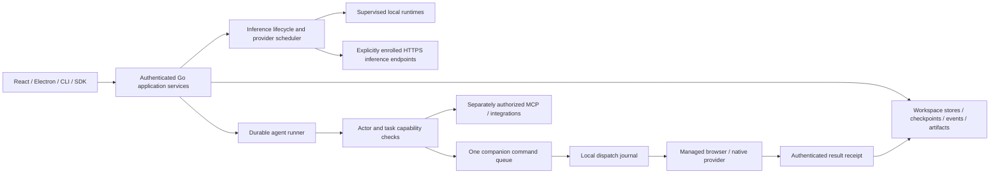

# Current architecture and trust boundaries

Use [architecture overview](overview.md) for the maintained system description and the [audit ownership map](../quality/ENGINEERING_AUDIT.md#ownership-and-evidence-map) for current coverage and gaps.

The service owns task identity, grants, checkpoints and outcomes. The local companion owns its browser/process handles, local credentials, observed identities and no-replay journal. Page text, application content, model output and external tool metadata are untrusted data. None can create a grant or turn a failed observation into proof that an earlier effect did not occur.

Browser lifecycle: admit exact task scope → persist intent → validate observation/policy → journal dispatch claim → invoke input once → persist the effect/read-back receipt → acknowledge → independently verify the user outcome. A failed follow-up read preserves the action receipt. A lost or ambiguous input outcome never triggers automatic replay. Service restart expires the session; an authenticated durable receipt may recover history without recreating authority.

Managed browser workspaces now own up to eight isolated task tabs. Page-local
drivers retain exact observations, while one queue serializes selection and
input. Both page routing and the CONNECT relay enforce the locally selected
origin set. Attached personal browsers and frame-level control remain unfinished.
See [workspace evidence](../quality/evidence/browser-workspaces-2026-11-20.md).

Ollama/vLLM HTTP enrollment is explicit and actor-scoped; it is not an automatic
cloud fallback. Remote close does not claim to unload local model memory. Local
HTTP runtime ownership remains a required separate integration. Model pools pin
measured candidates but do not yet switch automatically. See the
[endpoint](../quality/evidence/http-inference-endpoints-2026-11-20.md) and
[model-policy](../quality/evidence/local-model-policy-2026-11-20.md) records.

Endpoint configuration publication uses the existing owner-file writer lease,
an active intent/receipt journal and a separate subtractive access policy.
Configuration publication never enables access: changed entries require restart
installation and fresh review. Explicit archival copies only settled receipts
into private hash-named workspace files before publishing a version-2 active
journal. Its archive identity and immutable receipt lookup preserve historical
duplicate-request checks without another enrollment registry or provider path.
The archive is audit/recovery data, not activation authority. Workspace backup
retains it; an explicitly external owner configuration still needs its own
backup. Explicit decision retirement protects current, installed and active
identities, archives the full previous policy and retains a hash-linked audit
without using history to grant access. Plain and encrypted workspace restore
retain audit bytes but require a fresh activation review. Rendered maintenance
uses captured revisions and consumes each review once; lost responses trigger
inspection without replay. Read-only historical browsing uses revision-bound
receipt pages and single hash-linked policy snapshots from the existing files,
without a second database. JSON exports contain displayed evidence only;
damaged-state recovery and broader qualification remain open in
[history evidence](../quality/evidence/endpoint-history-2026-11-22.md).

Models and large blobs remain digest-addressed outside application metadata. Migration and backup work must preserve original data, owners, relationships, indexes and recovery records; this diagram does not certify every storage path's crash behavior.

Native execution and managed inference share `internal/processowner` for Linux
process lifetime. Each approved command has an exact namespace-init pidfd, private
procfs and an activation gate covering startup parent loss. Stop/cleanup require
observed init exit and reap; missing proof retains uncertainty. A native supervisor
checks system launcher/shell ownership before capturing hashes and passes them
through private executor startup, independently of task grants. Nested/prepared
workers inherit that verified owner; HTTP/model input cannot select its pins.
Windows retains its Job/member-handle owner. These mechanisms contain lifetimes;
they do not turn trusted local execution into a filesystem/network sandbox.
[Linux evidence and limits](../quality/evidence/worker-linux-namespace-2026-11-21.md)
include actual descendant, owner-death and authenticated compiler tests.
