# OffGrid workspace tour

This tour follows the v0.4.33 interface captured on **25 November 2026**.
The screenshots use isolated sample conversations, documents, models, and agent
profiles. They show the real UI, with fixture responses rather than live model
inference. The terminal captures run the actual packaged v0.4.33 CLI.
Your installed release and connected service may expose different capabilities.
See [image provenance](../images/README.md) for versions, scope, and regeneration.

## Find your work

Startup pairs the compact OffGrid mark with one loading status. The mark gently
fades without changing shape or position. The same entrance stays visible while
the initial model list, conversation history and selected conversation are restored.
Connection failures keep the same visual identity with a reason and Retry; a
stalled application offers reload. There is no rotating greeting or seconds counter.
Appearance's Reduce motion setting and the system accessibility preference disable
the animation. Technical service details remain available in desktop recovery.
Background refreshes and running tasks do not reopen the startup screen.

The destination rail opens Chat, Library, Activity, and Models. The adjacent
sidebar shows recent conversations in Chat and searchable categories in Settings.
Collapse it when you need more space; narrow windows use a navigation drawer.
Settings is at the foot of the rail. Agents are available through **Settings →
Models & responses → Agents**, alongside model management and response preferences.

Start in Chat for a request. Use an agent profile when the work needs its configured
instructions and tools. Activity shows saved work, approvals, results, and recovery.
Opening a document or changing settings keeps your unsent draft available.

On first use, **Inference engine** checks preparation separately from the service
connection and model list. **Prepare engine** is an explicit action; opening the
guide starts no download. If the status cannot be read, **Try again** checks it
without starting preparation. Services that do not offer engine setup here show
an explanation. Choosing a model or importing one offline remains available.
Engine readiness alone does not finish setup: send a prompt and receive a reply.

## Chat

Choose an installed model beside the composer, write your request, and send it.
The model button uses a compact name; its searchable chooser retains full names
and exact identities. If there are no installed chat models, that same chooser
explains setup and links to **Models**. **Return to your draft** brings you back
without sending the request. A removed or unavailable saved choice is kept until
you explicitly replace it. Attach files or select sources as needed. Response settings
link to the relevant configuration without putting model installation or voice
setup in the writing area.

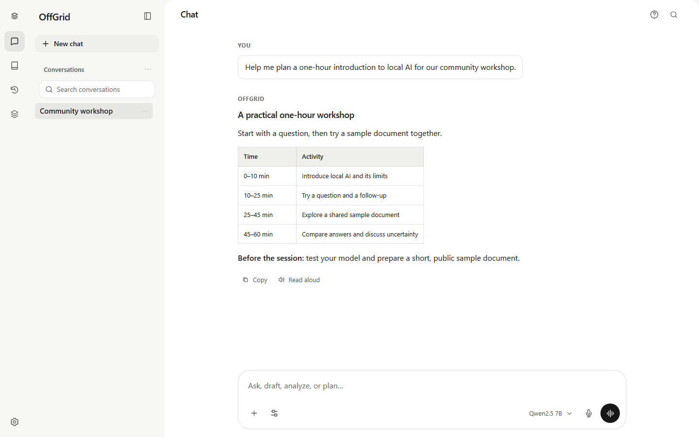

While a response arrives, scroll up to read earlier work without being pulled
back to the latest text. Return to the bottom or use **Latest** to follow again.
Progress and **Stop** remain available while work is running.

**Settings → Models & responses → Response display** offers **As it is generated**
and **When complete**. The preference is saved for the local account and connection.
Live text is provisional. Document checks and runtimes without streaming can delay
its display; the preference does not bypass evidence validation.

### Dark mode

Choose a separate dark palette in Appearance, or follow the system light/dark mode.
The same controls and source information remain available in either mode.

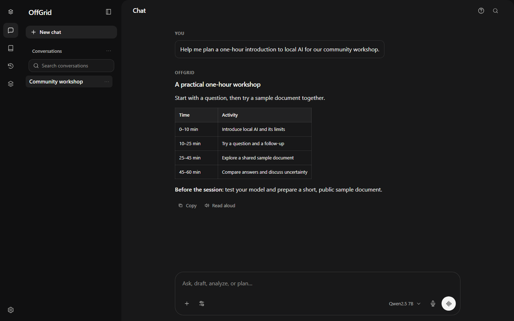

## Quick window and voice

The desktop **Quick window** opens the same workspace in a compact form while
OffGrid runs in the background. Configure its shortcut in **Settings → Quick
window**. The initial shortcut is **Ctrl+Shift+Space** on Windows and
**Command+Shift+Space** on macOS. A shortcut collision is reported.

The current model sits beside the input actions, and folder selection is under
Attach. Expand returns to the full workspace with your draft intact. On Windows,
the compact window is frameless and grows for menus, work, or voice instead of
using the full window's maximize and resize controls.

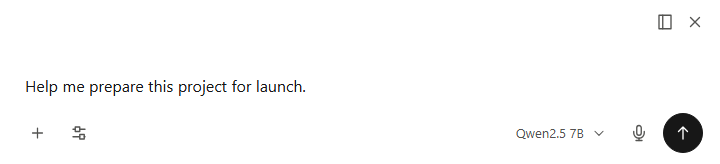

The compact view grows when there is work to show. Its expand control takes the
same conversation back to the full workspace.

Text, voice, and full-window changes share one short transition. The outgoing
view fades before the window changes size, then the new view appears at its final
size. Both system and Appearance reduced-motion preferences skip the movement.
Switching views keeps your draft; leaving Talk stops capture immediately.

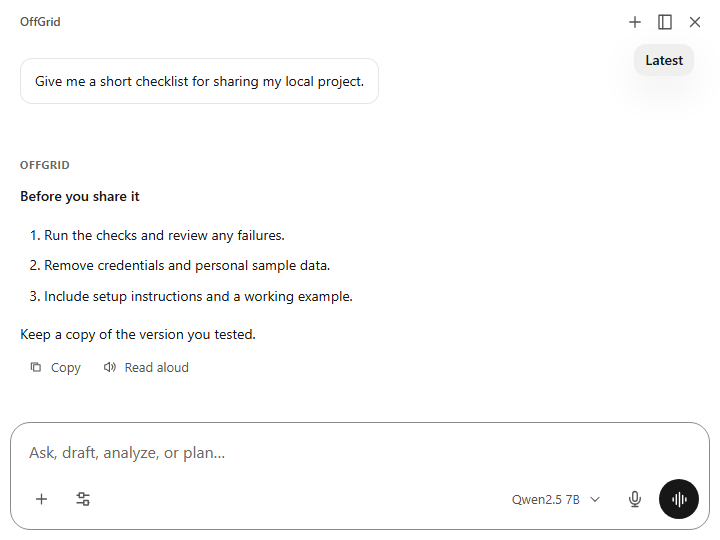

**Talk** switches the text workspace into a voice view. There is no dimmed Chat
behind it. Listening, transcription, and playback have distinct states; the visual
responds to microphone levels and respects reduced motion. Leaving Talk restores
the conversation and draft. Ordinary microphone dictation places text in the
editor for review; Talk sends utterances after you finish speaking.

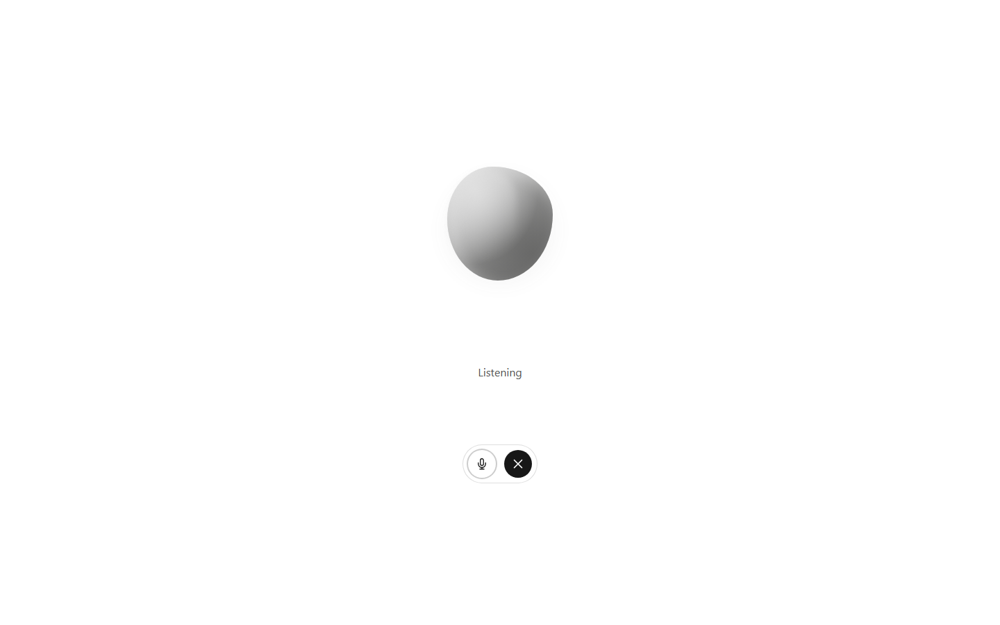

Escape hides the quick window and stops microphone capture and playback. Hiding
a window does not cancel accepted work; use its Stop control for that. Quit stops
the desktop host. Configure recognition and speech models in **Settings → Voice**;
missing capabilities lead to setup, not an automatic download. See
[voice setup and controls](voice.md) for requirements and current limitations.

## Files and the document reader

Attached files appear as compact tiles with filenames and processing state.
Upload failures remain visible for recovery; an unknown outcome is not replayed
automatically. Resolve failed draft attachments before sending. Files attached in
Chat stay with that conversation and are not automatically added to Library.

Open a tile to read its source beside the conversation. The reader separates its
file tabs from the viewing toolbar. The filename control opens page thumbnails;
zoom and download are on the right. Search and alternative views are in the
options menu. Page navigation and extraction coverage sit in the footer.

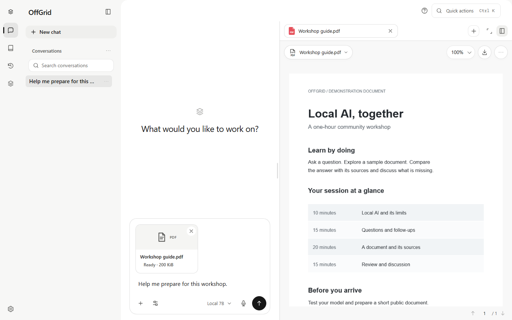

Drag the split handle, or focus it and use arrow keys, to resize the reading area.
Home and End choose its limits. Expand gives the document more room; narrow
screens switch between the document and conversation. The canvas displays one
source page at a time.

Up to eight open source tabs retain their own page, zoom, and search within the
current conversation. Closing a reader tab does not remove its attachment. The
plus button adds an unsent file. Thumbnails load in bounded groups, and temporary
image resources are released when the list closes or changes.

On compatible services, **Ask about this page** pins that page and extraction
revision to an unsent question. Moving the reader afterwards does not change the
question's source. Remove its source chip to return to normal document scope.
Library sources also support selected extracted blocks where the service provides
source scopes; headings, table headers, and linked footnotes remain associated.

A rendered original is not proof that every part was understood. Read the coverage
status: text can be available while figures, scans, or other content still need
review. Source and revision identities remain attached to evidence. See
[Knowledge and source limitations](embeddings.md).

## Models

Open **Models** from the rail. Its three views have distinct jobs:

| View | Use it to |
| --- | --- |
| Installed | Select a downloaded model and inspect runtime readiness |
| Discover models | Browse catalog suggestions and review their requirements |
| Search Hugging Face | Search public repositories and choose a supported package |

The **Model category** control switches among language, embedding, recognition,
and speech-generation models. Category filters and unsubmitted searches are
retained as you move between views. Model bytes on disk do not establish that
its runtime, vision, or tool capabilities are ready.

**Downloads** keeps ongoing and interrupted transfers together across categories
and views. Cancel stops the transfer; Resume continues its saved source only when
you choose it. Cancelled history starts collapsed on return. Expanding Downloads
keeps it open while progress changes, and discarding partial data requires confirmation.
If a status read fails, **Check saved state** reads the existing operation without
starting it again.

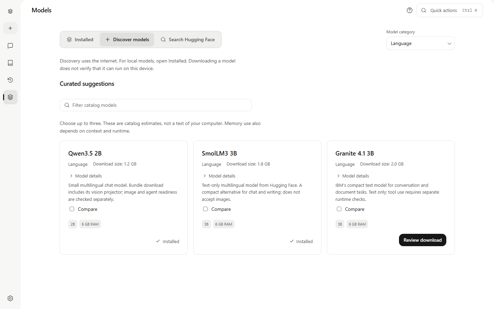

Choose **Review download**, inspect the package, license, and requirements, then
start the download. Review alone does not download anything. **Installed** brings
you back to models already on the connected service. If you arrived from a missing
model in Chat or Agents, **Return to your draft** restores that flow without sending
it. See [model discovery and recovery](model-discovery.md).

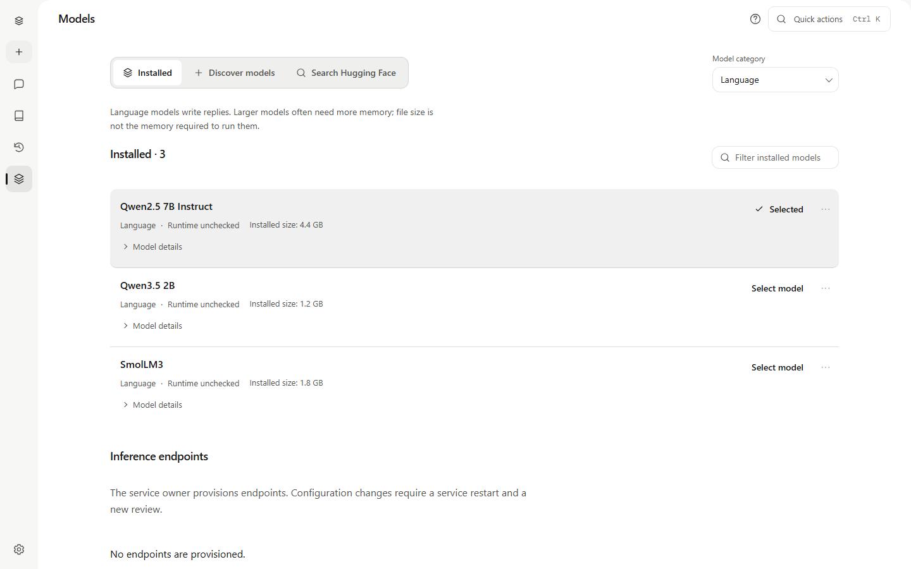

## Knowledge

**Library** is the destination for reusable Knowledge documents. Use **Add
document**, review the destination collection and its audience, then import.
Closing the review sends no files. A private collection and the legacy shared
Workspace collection have different audiences; choose deliberately.

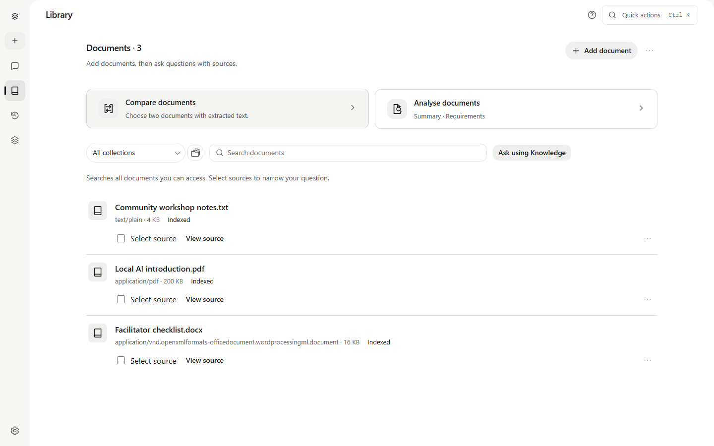

The collection filter, collection-management icon, and document-name search share
one toolbar. This search finds documents by name; it does not search their contents.
Select source checkboxes before **Ask using Knowledge** to narrow a question.
An unrestricted Knowledge question uses all accessible sources, independently of
the visible library filter. Library pages contain at most 30 documents.

Collection management lists collections next to their details and members. New
collections are private. Only their owner can change the audience; administrative
access does not implicitly grant private content access. A document's **Move to
collection** action reviews its destination audience before moving it. If membership
changes during review, refresh the policy before proceeding.

**Analyse documents** separates Summary and Requirements. Choose sources and a
workflow before starting a job, then inspect its coverage, evidence, and history.
Opening the workflow does not import, analyse, or share files automatically.
Incomplete source coverage must remain visible in its results and exports.

## Document comparisons in Knowledge

1. In Library, open **Compare documents** and choose the earlier and later sources.
2. Start the comparison. It compares retained text and cells without requiring an
   embedding or generation model.
3. Read aligned changes and use **View source** to inspect their retained evidence.
4. To compare another pair, change either selector or swap the documents, then run
   the comparison again. Old results hide when the selected pair changes.

Each new run resolves the current extraction revisions. **Comparison history**
reopens the exact revisions used by a saved run, not whatever replaced them later.
It can also recover work when a submission's response was lost. Access to both
source collections is checked again when results are opened.

The status row reports coverage. **Extraction coverage** explains unread material;
**Export comparison** offers JSON, CSV, or Markdown where supported. Exports retain
source references, revisions, and unresolved gaps. The current artifact limit is
8 MiB; an oversized result fails explicitly instead of dropping evidence.

A text or cell comparison is not a complete review of unread scans, figures, or
visual meaning. Downloaded exports cannot be recalled after access is revoked.
See the [document qualification evidence](../quality/README.md) for tested paths
and outstanding release gates.

## Agent profiles

Create a profile for recurring work, choose its model, and write its instructions.
Configure only the tools and context the task needs. Save the profile, then choose
**Use in Chat** to start work with it.

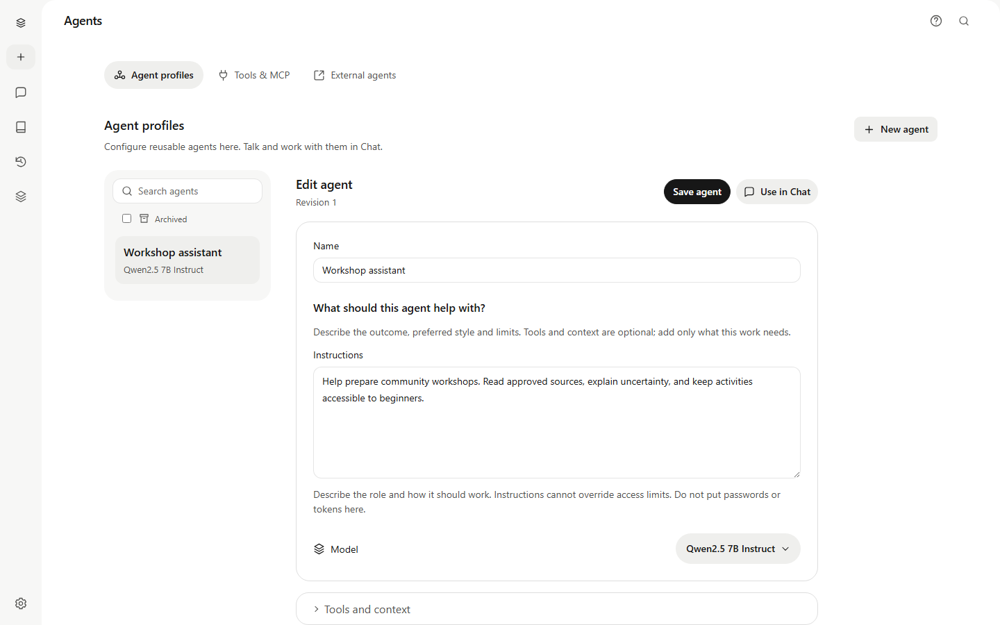

Profile search and archived entries stay with the list; Save and Use in Chat are
at the editor heading. Duplication, archiving, and reviewed permanent deletion are
separate maintenance actions. Review what deletion includes before confirming;
backups and independent records have separate retention boundaries. See the
[agent guide](agents.md).

**Tools & MCP** manages connected tools. **External agents** manages separate
Hermes and OpenClaw runtimes and their readiness. Installation, a successful model
reply, and a qualified tool workflow are different checks. See [MCP](mcp.md),
[external agents](external-agents.md), and [computer tasks](computer-tasks.md).

## Settings and Help

Settings separates everyday preferences from model behavior, access, and storage.
Search its sidebar to locate a setting. Search replaces the settings content
with result rows showing each setting and its section. Choose a row to open and
focus that setting without changing its value; clear search to return to the
selected section.

| Section | Contains |
| --- | --- |
| General | Interface language and account-related controls |
| Appearance | System/light/dark mode, palettes, text size, and reduced motion |
| Models & responses | Models and Agents destinations, response display, context and answer limits |
| Voice | Recognition model, speech model, and voice selection |
| Quick window | Desktop shortcut and quick-window entry point |
| Terminal | Entry point to terminal-specific display controls |
| Access & data | Computer access and workspace data information |
| Local storage | Desktop storage inspection and supported cleanup actions |
| About | Version and application information |

Quick window and Local storage are desktop-specific. The browser screenshot below
therefore has fewer sections. Themes and text preferences apply to presentation;
changing them does not change collection permissions or model capabilities.

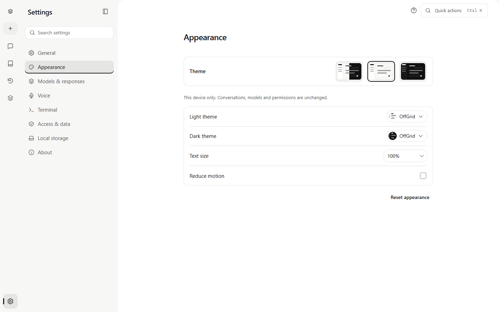

Response limits apply to Chat on the current connection; agent profiles retain
their own model and limits. Context allocation and maximum answer length are
separate controls. A larger context can require more memory.

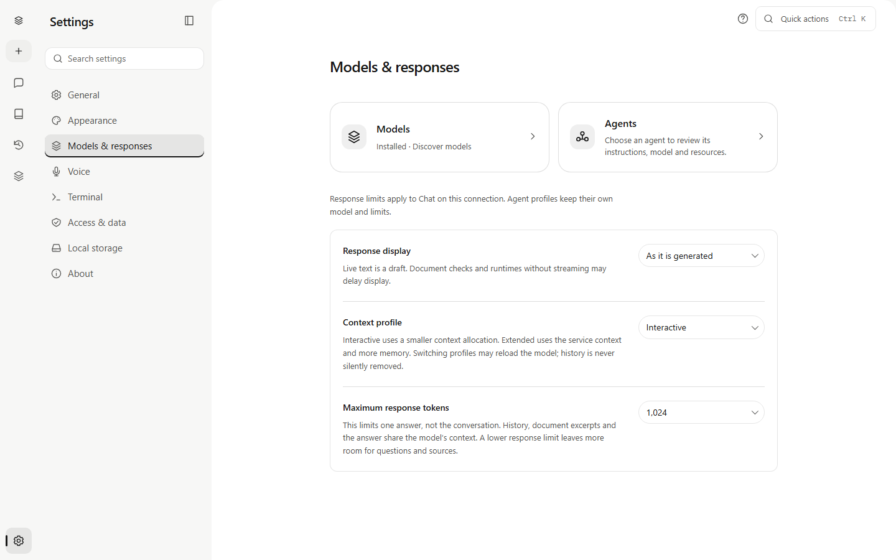

Voice selectors show readable model names. Their **Technical details** reveal
exact repositories, revisions, and runtime information. Unavailable choices retain
the reason, and an explicit saved selection is not silently replaced.

The interface offers 29 languages. Translation completeness, native-language
review, OCR languages, and speech-language quality are separate concerns;
a translated interface does not qualify document or speech processing in that
language. See [localization guidance](../advanced/workspace-ui.md).

**Help** opens searchable local guidance in the workspace. Topics cover Chat,
models, documents, agents, voice, Activity, and service connections, plus desktop
Quick window and CLI guidance. Topic links open the relevant page without starting
work or granting access. The Help heading and close action stay visible while
topics and articles scroll underneath. Escape returns to the previous page and
focus, retaining the conversation draft.

For failed chat deletion, retain unsuccessful selections for retry and inspect the
recovery details. If work is active, choose whether to stop it or keep it in
Activity. Deleting a conversation does not erase independent work or backups.
See [history management](history-management.md).

## Desktop terminal

On supported Windows desktop builds, the terminal shares the main work area with
Chat. Choose **OffGrid CLI** or **Agent** to begin in a local folder. The new-tab
menu also offers PowerShell. **Back to workspace** reveals the previous page and
keeps its draft and terminal sessions open.
Closing a terminal tab stops its owned processes; leaving an Agent session with
`/exit` returns to its shell.

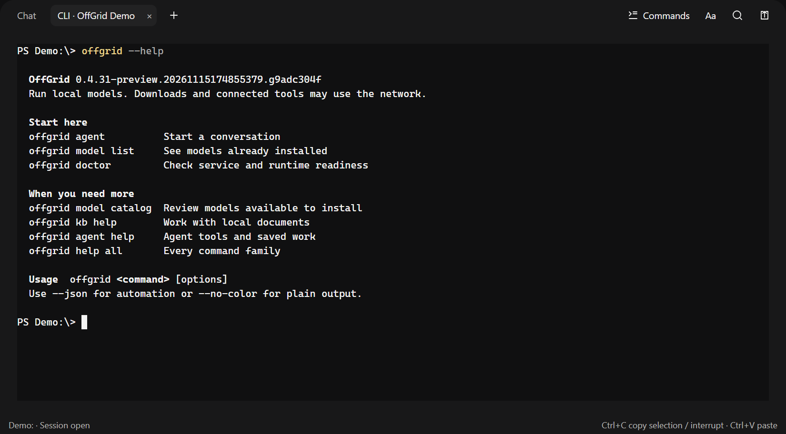

**Commands** shows captured output and shell-reported completion for the selected
command. This helps inspection; a successful shell exit is not independent proof
of a command's effects.

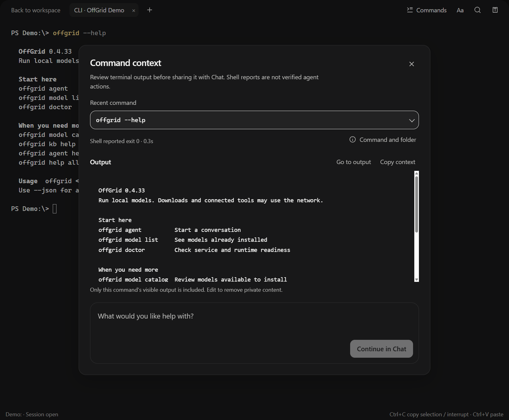

These images use `0.4.31-preview.20261115174855379.g9adc304f`. The temporary `Demo:`
PowerShell drive points at an isolated folder. See [desktop terminal](../setup/desktop-terminal.md)
for local permissions, shortcuts, display preferences, and platform availability.

## Animated overview

This 16-second GIF cycles through four screenshots. It is a slideshow, not a
recording of model generation or task execution. The static images above show
the same views without animation.

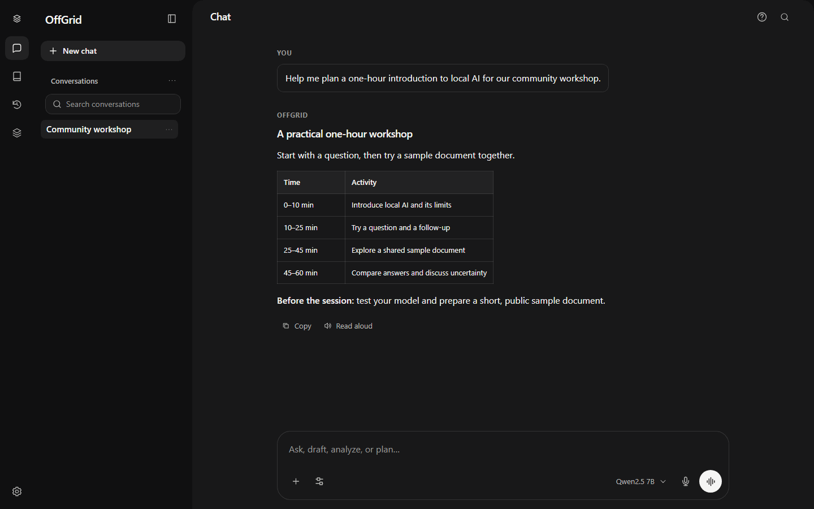

## Refreshing the images

Follow the [capture instructions and provenance record](../images/README.md).
Use disposable state and review every image before replacing documentation assets.
Earlier captures remain in [the historical image archive](../images/old-images/README.md).
