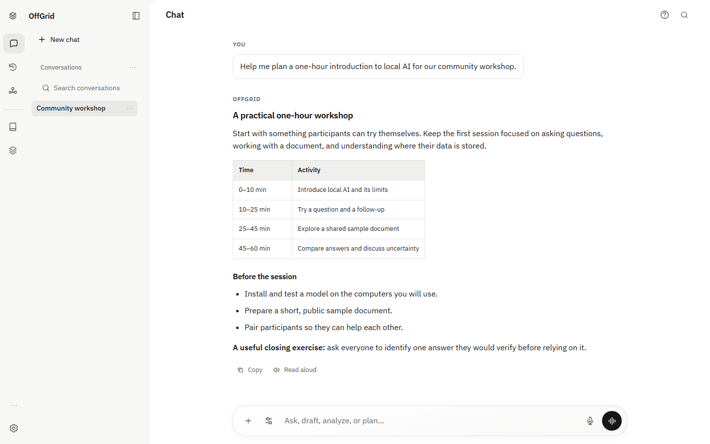
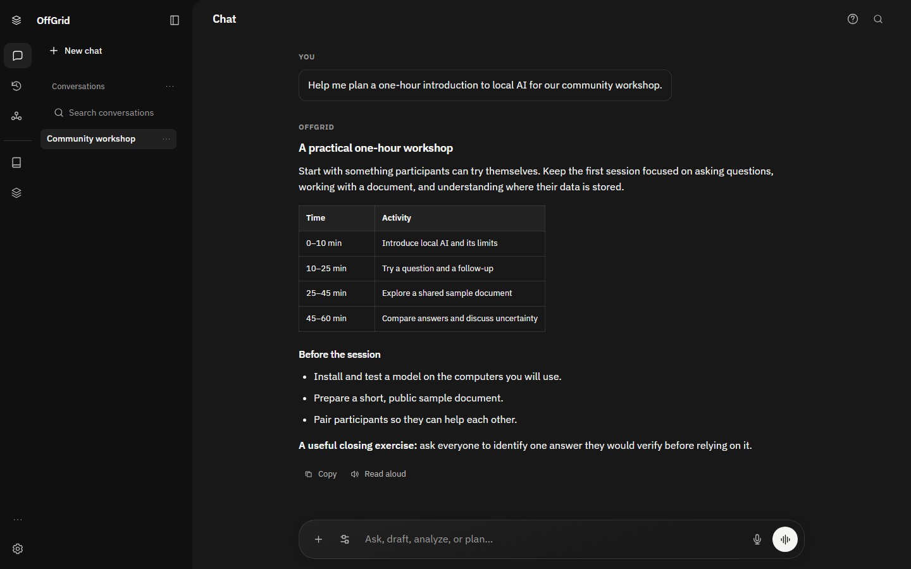
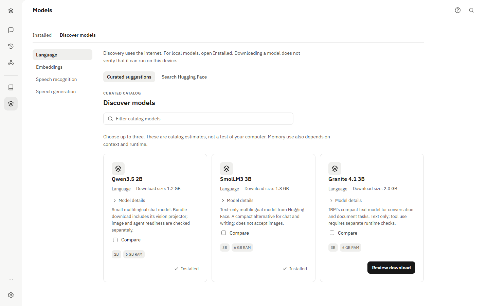
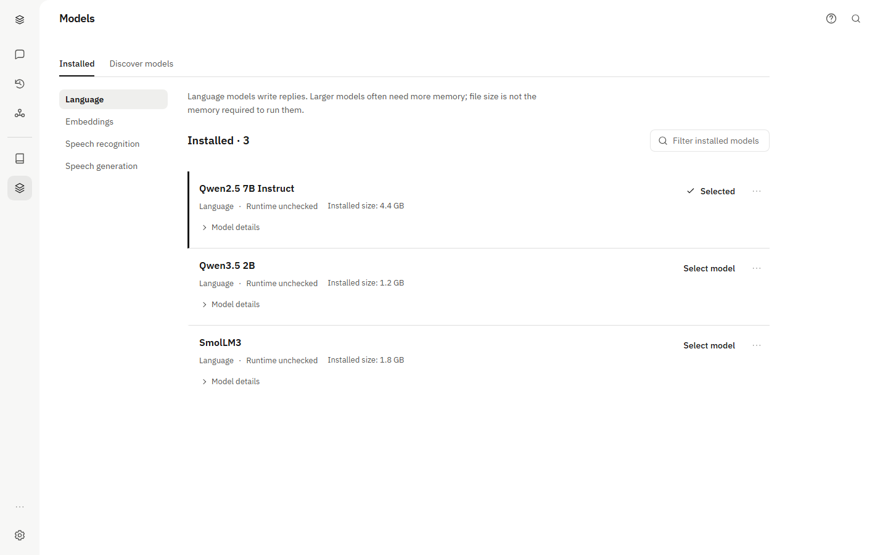
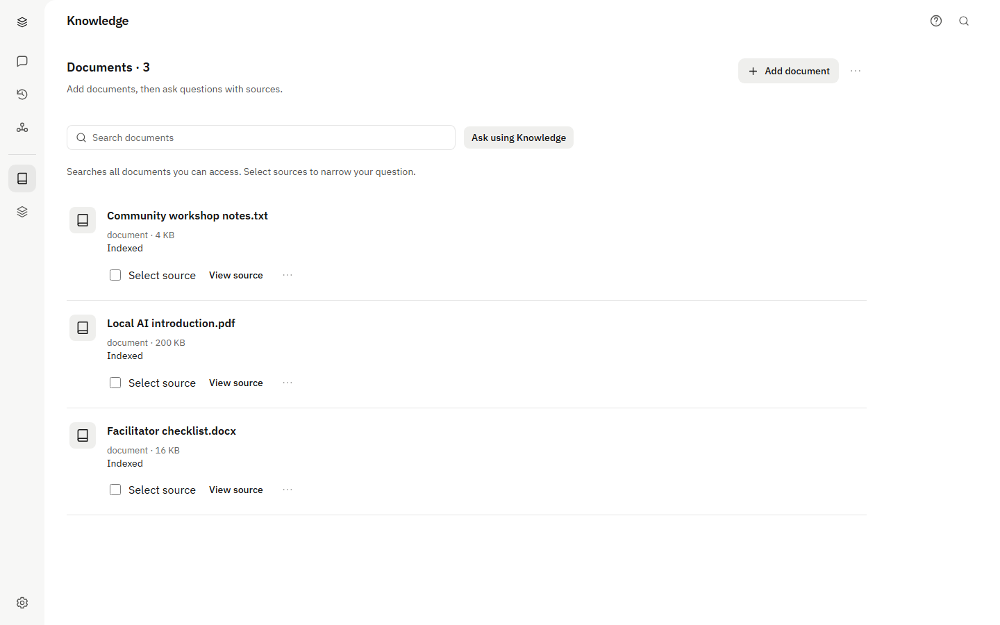
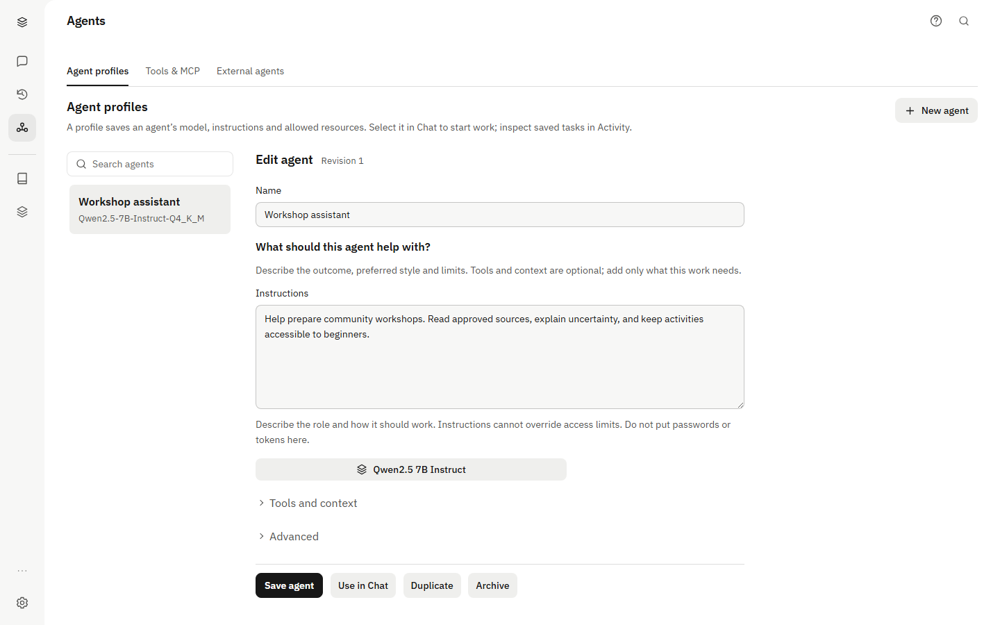
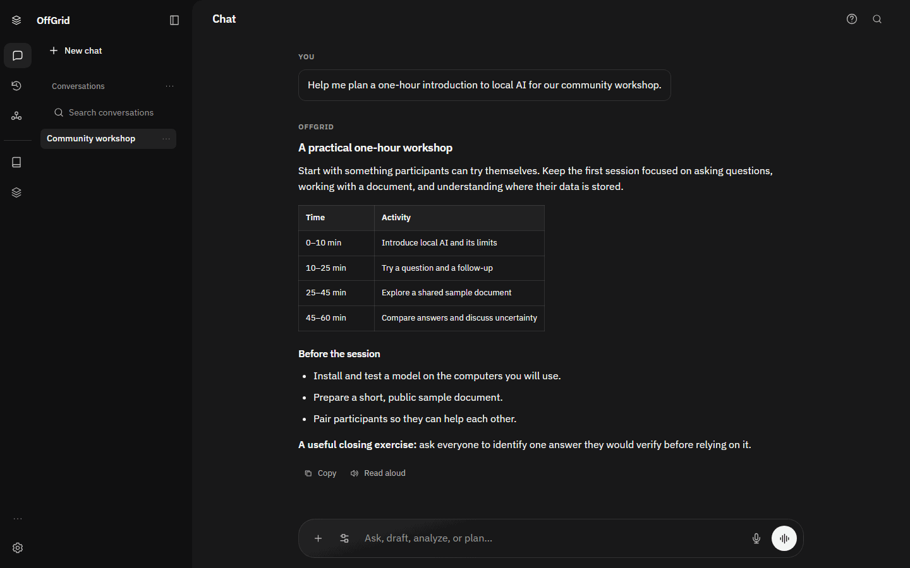
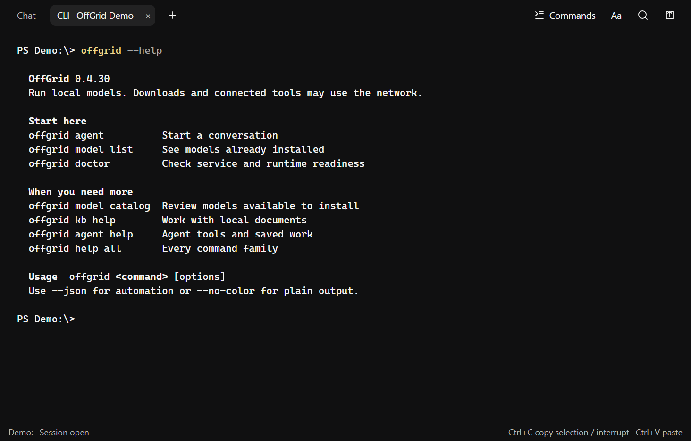
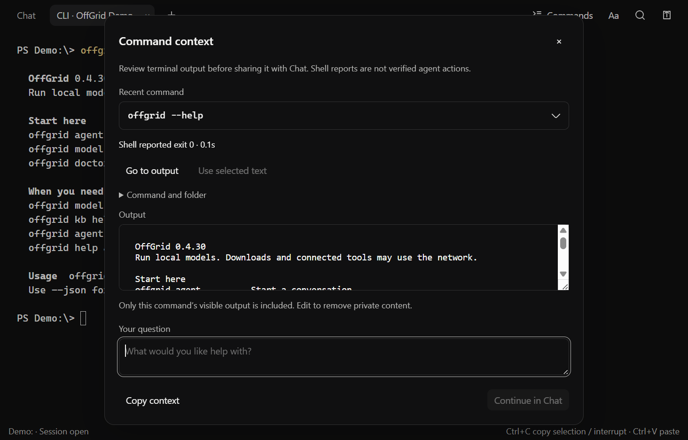

# OffGrid workspace tour

These screenshots show the 0.4.30 renderer with isolated demonstration
data. The conversation and document/model library entries are samples, not model-quality or
document-ingestion benchmark results. Your installed release may look different.

## Chat

Keep the conversation in the main workspace. The composer provides attachments,
response settings and voice controls without opening a separate setup page.



### Dark mode

The same conversation in dark mode. Choose a theme in Settings to suit your workspace.



## Models

**Discover models** presents catalog information, estimated memory requirements
and a download review. Discovery uses the internet; an installed model's runtime
and image capabilities are checked separately.



**Installed** keeps local choices separate from discovery. This sample library
shows three language models and the current selection. Runtime readiness is
shown explicitly rather than inferred from a model's presence on disk.



## Knowledge

Use Knowledge for documents you want to reuse across conversations. Files attached
directly in Chat stay with that conversation. See the [Knowledge guide](embeddings.md)
for supported preparation paths and source limitations.



## Agent profiles

Save a model and instructions for a recurring task, then select the profile in
Chat. Tools and context are optional; configure only the resources that task needs.



## Animated overview

This 16-second GIF cycles through four captured screens. It is a screenshot
slideshow, not a recording of model generation or task execution. The static
images above show the same views without animation.



## Desktop terminal

The Windows desktop terminal shares the main work area with Chat. Use **+** to
open OffGrid CLI, Agent or PowerShell in a folder you choose. Leaving Agent with
`/exit` returns to the shell; closing a tab stops its owned processes.



**Commands** shows the command, captured output and shell-reported completion
status. Shell reports help you inspect a command; they are not independent proof
of its effects.



These terminal images use the actual locally packaged 0.4.30 CLI. A temporary
PowerShell drive named `Demo:` keeps the isolated capture directory readable;
the normal shell integration and command reporting remain enabled.

See [desktop terminal](../setup/desktop-terminal.md) for
keyboard shortcuts, local permissions and platform availability.

## Refreshing the images

From `apps/web`, set `OFFGRID_DOC_CAPTURES=1` and run
`npx playwright test tests/documentation-captures.spec.ts --workers=1`.
For the terminal, use the same variable and run
`node scripts/test/test-desktop-terminal-packaged.mjs PATH_TO_PACKAGED_EXE`
from the repository root. Both write to `build/documentation-captures`.
Inspect the images before copying selected files into `docs/images`.
Use isolated sample state; do not publish personal conversations or credentials.

To build the optional GIF from Chat, model discovery, Knowledge and agent captures,
run from the repository root:

```sh
npm install --prefix build/documentation-tools --no-save --ignore-scripts gifenc@1.0.3 pngjs@7.0.0
node scripts/maintenance/build-documentation-gif.cjs
```

The encoder writes `build/documentation-captures/workspace-tour.gif`; its tools
stay outside the application dependencies. Review each frame before publishing.
Superseded screenshots are retained in [old-images](../images/old-images/README.md)
and are not examples of the current interface.
